<h1>LKA09</h1>

<strong>Backend Developer</strong>

APIs · Databases · Systems · Open Source

 

  

 

### Tech Stack

| Area | Technologies |
| :-- | :-- |
| **Languages** | Rust · Python · TypeScript · JavaScript · Java · SQL |
| **Frontend** | Next.js · Remix · React |
| **Backend** | Node.js · NestJS · Spring Boot |
| **Database & Services** | PostgreSQL · Supabase · Firebase |
| **Security & Reverse Engineering** | Burp Suite · Ghidra |
| **Operating Systems** | Kali Linux · Ubuntu |
| **Tools & Infrastructure** | Docker · Git |

 

### Open Source

**[Chai.js](https://github.com/chaijs) · Contributor**

Contributing to the JavaScript assertion and testing ecosystem.

 

---

  <a href="https://github.com/LKA09">GitHub</a>
  &nbsp;·&nbsp;
  <a href="https://github.com/LKA09/Portfolio_Blog">Portfolio</a>

  

<!-- PROFILE_SYNC_START --><!-- 2026-11-12 01:24 UTC --><!-- PROFILE_SYNC_END -->
