<h3><code>lka09@github ~ $ ./contributions.sh</code></h3>

 

<code>BACKEND ENGINEER · API DESIGN · OPEN SOURCE</code>

  

<h3><code>lka09@github ~ $ whoami</code></h3>

<table>
<tr>
<td valign="top"></td>
<td valign="top"></td>
</tr>
</table>

 

<h3><code>lka09@github ~ $ ./backend-stack.sh</code></h3>

<b>Backend · Runtime · Data · DevOps</b>

<b>Languages</b>

<b>Also exploring · Web, Mobile & Game</b>

  

<h3><code>lka09@github ~ $ ./open-source.sh</code></h3>

Contributing to the <a href="https://github.com/chaijs"><b>Chai.js</b></a> ecosystem — JavaScript assertion tooling that helps developers write reliable tests.

 

<h3><code>lka09@github ~ $ ./status.sh</code></h3>

  

<h3><code>lka09@github ~ $ ./links.sh</code></h3>

<b>Backend-focused Student Developer</b>

  

 
Visitor counter includes a 2,000-view baseline offset; it is not a verified unique-visitor total.

  

Daily profile sync: <code><!-- PROFILE_SYNC_START -->2026-11-12 01:24 UTC<!-- PROFILE_SYNC_END --></code>

