<h1>LKA09</h1>

<strong>Backend Developer && security</strong>

APIs · Databases · Systems · Open Source

 

  

 

### Tech Stack

| Area | Technologies |
| :-- | :-- |
| **Programming Languages** |   |
| **Frontend** |  |
| **Backend** |  |
| **Database & Services** |  |
| **Security & Reverse Engineering** |   |
| **Development Tools** |  |
| **Operating Systems** |  |

 

### Open Source

**[Chai.js](https://github.com/chaijs/chai) · Contributor**

**[PR #1895 — Fix Symbol-key handling in `.keys()` assertions](https://github.com/chaijs/chai/pull/1895)** · Merged

Fixed a bug where object-based key expectations ignored enumerable `Symbol` keys. Updated the core assertion logic, documentation, and regression tests.

`lib/chai/core/assertions.js` · `test/expect.js`

 

---

  <a href="https://github.com/LKA09">GitHub</a>
  &nbsp;·&nbsp;
  <a href="https://github.com/LKA09/Portfolio_Blog">Portfolio</a>

<!-- PROFILE_SYNC_START --><!-- 2026-11-22 06:27 UTC --><!-- PROFILE_SYNC_END -->
